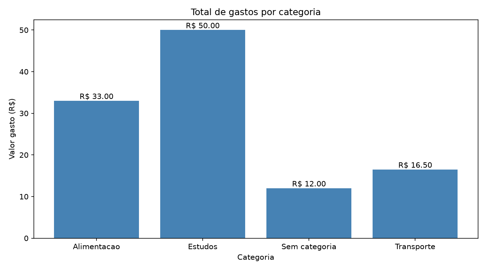

# Analisador de Despesas

Projeto de análise de dados desenvolvido como parte do Desafio Full Stack Semanal.

O programa lê despesas de um arquivo CSV, identifica problemas nos dados, realiza a limpeza, calcula métricas e gera um gráfico dos gastos por categoria.

## Tecnologias utilizadas

- Python 3.14
- pandas
- matplotlib
- Visual Studio Code

## Funcionalidades

- Leitura de dados de um arquivo CSV;
- identificação de valores ausentes;
- remoção de registros duplicados pelo `id`;
- preenchimento de categorias ausentes;
- separação das despesas sem valor conhecido;
- cálculo do total gasto;
- cálculo da média por despesa;
- cálculo do total por categoria;
- geração de gráfico de barras.

## Tratamento dos dados

Durante a análise foram encontradas as seguintes situações:

- um registro duplicado com o `id` 3;
- uma despesa sem categoria;
- uma despesa sem valor.

O registro duplicado foi removido. A categoria ausente foi preenchida com `Sem categoria`. A despesa sem valor foi preservada nos dados limpos, mas excluída dos cálculos.

## Resultados

Foram utilizadas oito despesas com valores conhecidos.

- Total conhecido: **R$ 111,50**
- Média por despesa válida: **R$ 13,94**

### Total por categoria

| Categoria | Total |
|---|---:|
| Alimentação | R$ 33,00 |
| Estudos | R$ 50,00 |
| Sem categoria | R$ 12,00 |
| Transporte | R$ 16,50 |

## Gráfico



## Observações da análise

1. A categoria com o maior gasto foi Estudos, com R$ 50,00.

2. As categorias Estudos e Alimentação somaram R$ 83,00, representando aproximadamente 74,4% do total conhecido.

3. Uma limitação da análise é a existência de dados ausentes. Como o valor do Suco não foi informado, essa despesa foi excluída dos cálculos e o total real pode ser maior que R$ 111,50.

## Como executar

Clone ou baixe o projeto e abra a pasta no Visual Studio Code.

Crie o ambiente virtual:

```powershell
py -m venv .venv
```

Ative o ambiente:

```powershell
.\.venv\Scripts\Activate.ps1
```

Instale as bibliotecas:

```powershell
python -m pip install pandas matplotlib
```

Execute a análise:

```powershell
python analise.py
```

O programa mostrará os resultados no terminal e criará o arquivo `gastos_por_categoria.png`.

## Estrutura do projeto

```text
02-analise-despesas/
├── analise.py
├── despesas.csv
├── gastos_por_categoria.png
└── README.md
```