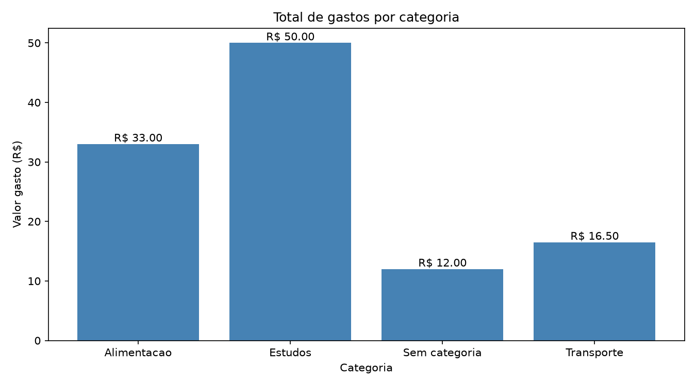

# Desafio Full Stack Semanal

Repositório de estudos com projetos práticos desenvolvidos semanalmente para aprender programação, registrar minha evolução e construir um portfólio.

Cada semana apresenta um problema, uma solução e os conhecimentos praticados. Os projetos incluem um gerador de QR Code, uma análise de despesas em Python, uma API de ideias em Java e uma análise de empréstimos com SQL.

## O que significa o desafio?

**Full Stack** é o desenvolvimento que envolve a interface utilizada pelas pessoas (**front-end**), o processamento no servidor (**back-end**) e a integração com dados e serviços.

Neste repositório, o nome representa o objetivo da trilha de aprendizado. Cada projeto exercita uma parte desse caminho. A primeira semana trabalha front-end. A segunda introduz análise de dados com Python. A terceira pratica API REST e persistência em PostgreSQL. A quarta usa SQL para analisar os dados diretamente no banco. Os projetos têm escopos independentes e praticam competências complementares.

**Semanal** representa a proposta de aprender por meio de pequenas entregas, com um projeto por semana e documentação dos aprendizados.

## Projetos desenvolvidos

| Semana | Projeto | Tecnologias | Entrega |
| --- | --- | --- | --- |
| 01 | [Gerador de QR Code](01-gerador-qrcode/README.md) | HTML, CSS, JavaScript e QRCode.js | Página para gerar códigos a partir de texto ou URL e baixar a imagem em PNG |
| 02 | [Analisador de Despesas](02-analise-despesas/README.md) | Python, pandas e matplotlib | Leitura e limpeza de CSV, cálculo de indicadores e gráfico por categoria |
| 03 | [Caixa de Ideias](03-caixa-de-ideias/README.md) | Java 21, Spring Boot, Spring Data JPA, Jakarta Validation e PostgreSQL | API REST para cadastrar, listar e consultar ideias, com validação e persistência |
| 04 | [Empréstimos de uma Biblioteca](#semana-04--empréstimos-de-uma-biblioteca) | SQL e PostgreSQL | Contagens de empréstimos totais e em aberto por categoria |

## Semana 01 — Gerador de QR Code

Uma página que transforma um texto ou endereço em um QR Code.

### Funcionalidades

- Entrada de texto ou URL, com verificação de conteúdo vazio.
- Escolha entre três tamanhos: 128, 200 e 300 pixels.
- Exibição do código gerado na página.
- Substituição do código anterior ao gerar um novo.
- Download da imagem com o nome `meu-qrcode.png`.

### Aprendizados

Estruturação com HTML, estilos com CSS e Flexbox, manipulação do DOM, eventos de formulário, uso de uma biblioteca externa e download de imagens com JavaScript.

O download utiliza a imagem PNG disponibilizada pela biblioteca ou, como alternativa, converte o conteúdo do `canvas` em uma imagem.

### Como executar

Abra o arquivo `01-gerador-qrcode/index.html` no navegador. Informe um texto ou URL, escolha o tamanho e clique em **Gerar Código QR**. Depois, use **Baixar QR Code**.

É necessário acesso à internet para carregar a biblioteca QRCode.js, versão 1.0.0, usada pela página por meio de uma CDN. A geração acontece no navegador.

## Semana 02 — Analisador de Despesas

Um programa que lê despesas de um arquivo CSV, trata dados incompletos e duplicados e calcula os gastos por categoria.

### Funcionalidades

- Inspeção dos registros, das colunas e dos valores ausentes.
- Remoção de registros duplicados pelo campo `id`.
- Preenchimento de categorias ausentes com `Sem categoria`.
- Exclusão das despesas sem valor apenas da tabela usada nos cálculos.
- Cálculo do total conhecido, da média e da soma por categoria.
- Geração do arquivo `gastos_por_categoria.png`.

### Resultados com o CSV incluído

O arquivo contém dez registros. Após a remoção de uma duplicata, restam nove despesas, das quais oito possuem valor conhecido.

| Indicador | Resultado |
| --- | ---: |
| Total conhecido | R$ 111,50 |
| Média por despesa com valor conhecido | R$ 13,94 |
| Categoria com maior gasto | Estudos — R$ 50,00 |

A despesa de Suco está sem valor e não entra nos cálculos. Por isso, R$ 111,50 representa o total conhecido, e não necessariamente todas as despesas.



### Como executar no Windows

Com Python 3 instalado, abra o PowerShell na pasta principal do repositório e execute:

```powershell
cd 02-analise-despesas
py -m venv .venv
.\.venv\Scripts\python.exe -m pip install pandas matplotlib
.\.venv\Scripts\python.exe analise.py
```

Os comandos usam diretamente o Python do ambiente virtual, sem exigir sua ativação. Execute dentro de `02-analise-despesas`, pois o programa procura `despesas.csv` na pasta de execução.

Os resultados aparecem no terminal. O gráfico é salvo na mesma pasta e exibido em uma janela quando há suporte gráfico. Uma nova execução substitui o PNG anterior.

### Aprendizados

Leitura de CSV, uso de DataFrames, limpeza de dados, tratamento de valores ausentes, agrupamento por categoria, cálculo de indicadores e visualização com gráficos de barras.

## Semana 03 — Caixa de Ideias

Uma API local para cadastrar e consultar ideias no PostgreSQL. Cada ideia possui um identificador gerado pelo banco e um título obrigatório de até 100 caracteres.

### Funcionalidades

- Cadastro de ideias com identificador gerado automaticamente.
- Listagem de todas as ideias.
- Consulta de uma ideia pelo identificador.
- Rejeição de títulos ausentes, vazios, com apenas espaços ou com mais de 100 caracteres.
- Persistência dos registros após reiniciar a aplicação.

### Endpoints

| Método | Caminho | Resultado |
| --- | --- | --- |
| POST | `/ideias` | `201` com a ideia cadastrada; `400` para título inválido |
| GET | `/ideias` | `200` com uma lista; lista vazia quando não há registros |
| GET | `/ideias/{id}` | `200` com a ideia; `404` quando não encontrada |

Exemplo de corpo para cadastro:

```json
{
  "titulo": "Criar um organizador de livros"
}
```

### Como executar no Windows

É necessário ter JDK 21 e PostgreSQL instalados, o serviço do banco em execução e o banco `caixa_de_ideias` criado. Configure a conexão em `application.properties` conforme o [README do desafio](03-caixa-de-ideias/README.md), utilizando `${DB_PASSWORD}` para obter a senha.

Na primeira preparação, crie o banco pelo psql, caso ainda não exista:

```sql
CREATE DATABASE caixa_de_ideias;
```

No PowerShell, a partir da raiz do repositório:

```powershell
cd 03-caixa-de-ideias

# Selecione Java 21 apenas para esta sessão.
# Ajuste o caminho conforme sua instalação.
$env:JAVA_HOME = 'C:\Program Files\Java\jdk-21.0.12'
$env:Path = "$env:JAVA_HOME\bin;$env:Path"

# Informe a senha sem gravá-la no código ou no repositório.
$senhaBanco = Read-Host 'Senha do PostgreSQL' -AsSecureString
$env:DB_PASSWORD = [System.Net.NetworkCredential]::new('', $senhaBanco).Password
Remove-Variable senhaBanco

# Confira se o Maven está usando Java 21 e inicie.
.\mvnw.cmd -version
.\mvnw.cmd spring-boot:run
```

Execute os comandos no mesmo terminal. A seleção de Java 21 preserva a configuração padrão do Java 11 utilizada em outros projetos. A seleção do Java e a definição de `DB_PASSWORD` devem ser repetidas em terminais novos.

Após a mensagem `Started CaixaDeIdeiasApplication`, consulte a listagem em [http://localhost:8080/ideias](http://localhost:8080/ideias). Para encerrar, use `Ctrl + C`. Não é necessário recriar o banco ao iniciar novamente.

### Verificações realizadas

Os testes manuais confirmaram cadastro com `201`, listagem e consulta existente com `200`, consulta inexistente com `404` e rejeição dos quatro casos de título inválido com `400`. Os testes inválidos não criaram registros, e a ideia cadastrada permaneceu disponível após reiniciar a aplicação.

Essas verificações foram manuais; não foi criada uma suíte de testes automatizados dos endpoints.

### Aprendizados

Organização dos pacotes `model`, `dto`, `repository` e `controller`; injeção de dependências pelo construtor; mapeamento de rotas; validação de requisições; respostas HTTP; persistência com JPA e PostgreSQL; e configuração de Java 21 por sessão para manter Java 11 como padrão para o trabalho.

## Semana 04 — Empréstimos de uma Biblioteca

Um exercício de análise de dados em SQL. A tabela `emprestimo` reúne 12 empréstimos fictícios, registrados de 2 a 7 de novembro de 2026. Cada linha contém um identificador gerado pelo PostgreSQL, a categoria, a data do empréstimo e a indicação de devolução.

### Resultados

| Categoria | Total de empréstimos | Em aberto |
| --- | ---: | ---: |
| Tecnologia | 5 | 3 |
| Literatura | 4 | 2 |
| História | 3 | 1 |
| **Total** | **12** | **6** |

Metade dos empréstimos está em aberto. Tecnologia lidera nas duas contagens. A base não registra o prazo de devolução, então os registros em aberto não permitem identificar atrasos. Para medir a duração dos empréstimos encerrados, seria necessário registrar a data da devolução.

### Como executar

Conecte-se a um banco PostgreSQL local para o exercício. Com a tabela ainda por criar, execute os scripts na ordem abaixo.

| Ordem | Script | O que faz |
| ---: | --- | --- |
| 1 | [estrutura.sql](04-analise-de-ddos-iniciante/estrutura.sql) | Cria a tabela com chave primária, campos obrigatórios e indicador booleano de devolução |
| 2 | [dados.sql](04-analise-de-ddos-iniciante/dados.sql) | Insere os 12 registros fictícios |
| 3 | [consultas.sql](04-analise-de-ddos-iniciante/consultas.sql) | Lista os empréstimos por data e ID e calcula as contagens gerais e por categoria |

Execute a carga uma vez para evitar registros duplicados. As consultas podem ser executadas novamente sobre a mesma carga.

### Aprendizados

Criação de tabela e inserção de dados no PostgreSQL. Uso de `ORDER BY` para ordenar, `WHERE` para filtrar e `COUNT(*)` com `GROUP BY` para comparar categorias. A soma das categorias foi comparada com as contagens gerais.

## Organização do repositório

```text
Desafio_Full_Stack_Semanal/
├── README.md
├── 01-gerador-qrcode/
│   ├── README.md
│   ├── index.html
│   ├── style.css
│   └── script.js
├── 02-analise-despesas/
│   ├── README.md
│   ├── analise.py
│   ├── despesas.csv
│   └── gastos_por_categoria.png
├── 03-caixa-de-ideias/
│   ├── README.md
│   ├── pom.xml
│   ├── mvnw
│   ├── mvnw.cmd
│   ├── .mvn/
│   └── src/
└── 04-analise-de-ddos-iniciante/
    ├── estrutura.sql
    ├── dados.sql
    └── consultas.sql
```

## Continuidade

As próximas semanas podem ser adicionadas em novas pastas numeradas. A proposta é manter os projetos anteriores disponíveis e atualizar a tabela de entregas com os novos aprendizados.
